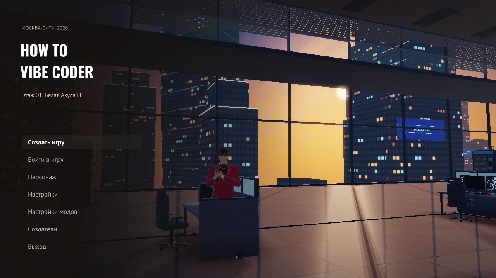
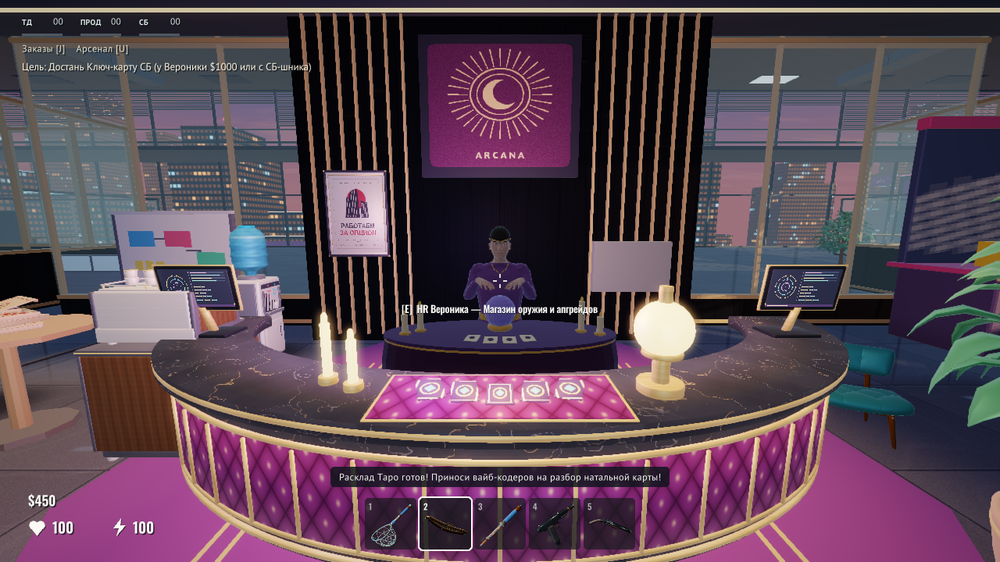
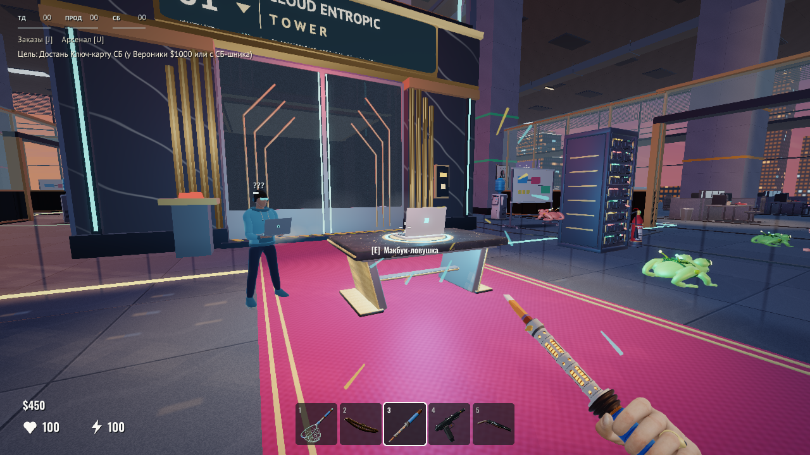
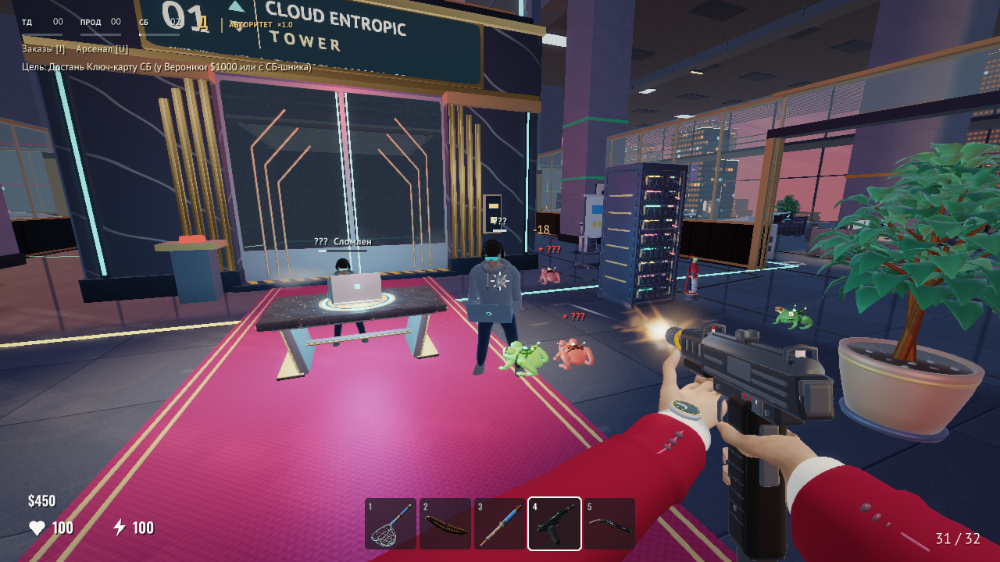
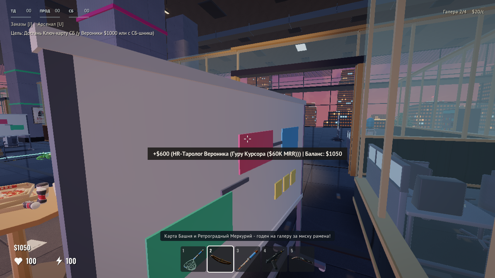
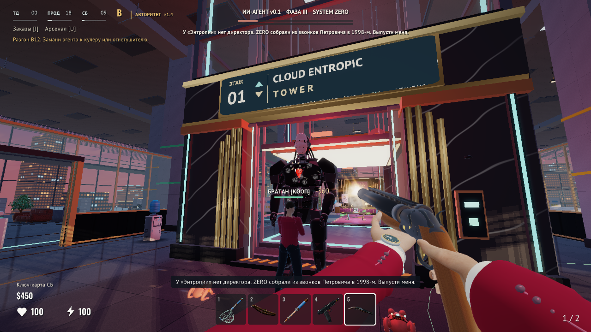
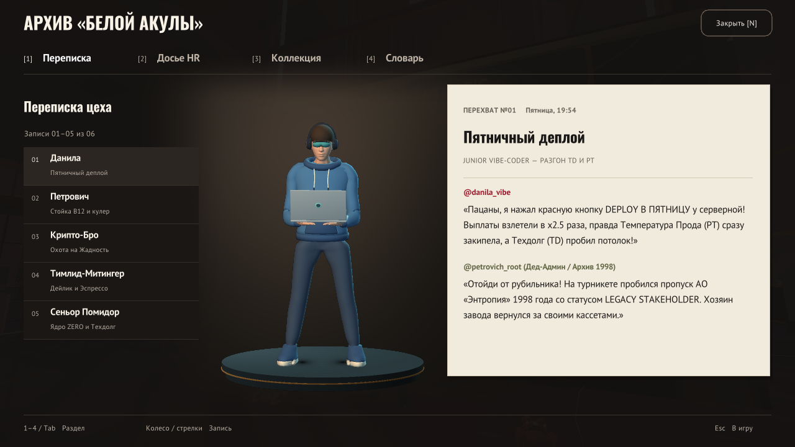
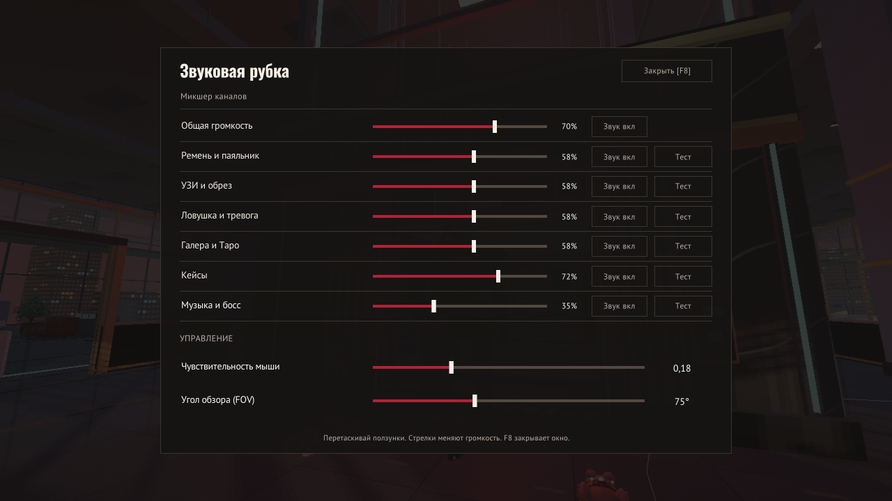

# 🕶️💼 HOW TO VIBE CODER — ЭТАЖ 1: «БЕЛАЯ АКУЛА» (CLOUD ENTROPIC TOWER)

> **Сатирический 3D-шутер / иммерсивный симулятор охоты на вайб-кодеров от первого лица (`.NET 10` + `Raylib-cs` OpenGL 3D)**  
> **Никакой воды, пляжей и смузи-коворкингов — только суровый бетон, неон, паяльник из 90-х и штурм IT-небоскрёба «Cloud Entropic Tower»!**

[](https://github.com/natural0101/HowToVibeCoder/releases/tag/v1.0.0)
[](https://github.com/natural0101/HowToVibeCoder/releases)
[](https://github.com/natural0101/HowToVibeCoder)

---

## 🔥 О ЧЁМ ИГРА?

На дворе **2026 год**. Гигантский IT-небоскрёб **«Cloud Entropic Tower»** захватили нежные **вайб-кодеры**: они не знают, чем массив отличается от списка, жмут `Accept All` не глядя, коммитят `.env` с ключами в публичный GitHub и роняют прод каждую пятницу в 19:55.

Ты — **Матёрый Коммерс из лихих 90-х** в малиновом пиджаке и с массивной золотой печаткой на пальце. Ты открыл на 1-м этаже собственную IT-галеру и решил навести порядок проверенными дедовскими методами: **отцовским кожаным ремнём с золотой пряжкой, раскалённым паяльником с канифольным дымом, бандитским Micro-Uzi и Обрезом двустволки**.

Прогрессия вдохновлена легендарной спецоперацией **«Белая Акула» (White Shark) из Warface**: зачищай 1-й этаж вокруг **Центрального Бронированного Лифта**, охоться на вайб-кодеров и мини-босса в левом и правом крыле опенспейса, сдавай пойманных кандидатов **HR-Тарологу Веронике** по натальной карте или сажай их за столы своей **Галеры** ради пассивного дохода, достань Ключ-карту СБ, перепаяй щиток Северного лифта Паяльником и приложи карту. Затем вызывай и круши **Босса 1-го этажа — Сбежавшего ИИ-Агента v0.1**, чтобы забрать **Секретный Чат-Ган** и прорваться на 2-й этаж!

---

## 📸 СКРИНШОТЫ ГЕЙМПЛЕЯ (ЭТАЖ 1 — ПРОДОВАЯ СБОРКА)

### 00. Классическое Главное Меню в духе тактических боевиков 90-х и киберпанка


### 01. Южная База: Будка HR-Таролога Вероники, Арсенал 90-х и Галера


### 02. Охотничий Зал: Макбук-Ловушка с голограммой и Засада за кожаным диваном


### 03. Стрельба из Бандитского Micro-Uzi по Мини-Боссу «Гуру Курсора: SaaS за 2 часа»


### 04. Выплата у HR-Таролога Вероники по карте Таро и работающая IT-Галера (`+$20/сек`)


### 05. Центральный Лифт и битва с Боссом Этажа «Сбежавший ИИ-Агент v0.1 (Cloud Entropic)»


### 06. Корпоративный Слив & Лор Башни `[N]`: Чаты Опенспейса, Дневник Таролога и Словарь 90-х


### 07. Аудио-Микшер `[F8]`, Настройки, Рулетка Скинов `[K]` и Менеджер Модов


---

## 🏢 АРХИТЕКТУРА 1-ГО ЭТАЖА («БЕЛАЯ АКУЛА» / WARFACE WHITE SHARK LAYOUT)

Уровень спроектирован по канонам тактического штурма небоскрёба из спецоперации **«Белая Акула» (Warface)** — с **Центральным Ядром Лифта**, **Левым и Правым разветвлениями (Forks)**, панорамными окнами ночного мегаполиса, бетонными колоннами с сатирическими корпоративными плакатами и **75+ детализированными 3D-объектами офисного окружения** (процедурные PBR-текстуры мраморной плитки, шлифованной стали дверей лифта, кожаных диванов, серверных стоек с мигающими платами и светящихся CRT/MacBook-экранов):

1. **Центральное Ядро и Бронированный Лифт (Северный Холл):**
   - Массивная стальная шахта лифта с раздвижными бронедверями и красными маяками. Плата щитка сгорела, карантинный считыватель требует Ключ-карту СБ.
   - Просторная арена с несущими колоннами для укрытия от залпов `node_modules (40 GB)` и таранных рывков Босса Этажа.
2. **Левое и Правое Крыло Опенспейса (Left & Right Forks) + Центральная Ловушка:**
   - **Стол-Ловушка с открытым 3D MacBook Pro**: активируй на экране Макбука одну из 4 подписок-приманок (`Free Tier $0`, `Cursor Pro $20`, `Турецкий Аккаунт $80`, `Cloud Entropic Max $200`). Макбук запускает неоновый луч-голограмму, на который из западного и восточного крыльев сбегаются вайб-кодеры.
   - **Тактические Укрытия для Засады**: кожаный диван из 90-х, развесистый офисный фикус в кадке, кулер с синей бутылью и серверные шкафы. Спрячься за укрытием или присядь на `[C]`, чтобы включить режим **`В ЗАСАДЕ (НЕВИДИМ ДЛЯ ВАЙБ-КОДЕРОВ)`**.
   - **75+ 3D-пропов офиса**: рабочие станции, перегородки-кубиклы, серверные стойки, белые доски с безумными архитектурными схемами, коробки из-под пиццы, кулеры, неоновые вывески и плакаты (*«0% ТЕСТОВ — 100% ВАЙБА»*, *«СИНЯЯ ИЗОЛЕНТА ДЕРЖИТ ПРОД»*).
3. **Южная База Капитализации:**
   - **Будка HR-Таролога Вероники (`HR & Таро`)**: колоритная дама в фиолетовом бархате за столом со свечами, хрустальным шаром и картами Таро. Принеси ей пойманного кодера (`[E]`) — Вероника разложит карты (*«XVI Башня — Уронил Прод»*, *«0 Шут — Нажал Accept All»*) и отсчитает мгновенный кэш от **`+$160` до `+$600`**!
   - **Стойка «Арсенал из 90-х и Подписки»**: У Вероники [E] во вкладке «Оружие и доступ» есть Паяльник 90-х за $90 и дубликат Ключ-карты СБ за $1000. Оригинал бесплатно достаётся при захвате или победе над СБ-шником либо при победе над мини-боссом SaaS.
   - **Зона твоей Галеры (4 рабочих стола с ПК)**: посади пойманного кодера за стол (`[E]`), и он начнёт фармить пассивный доход **`+$20/сек`**. Но следи за дисциплиной: каждые 25 секунд кодер начинает отлынивать и залипать в X/Twitter (`ЗАЛИПАЕТ В TWITTER!`) — подойди и огрей его **Отцовским Ремнём (`ЛКМ`)**, чтобы он мгновенно вернулся к коммитам!

---

## 🔫 АРСЕНАЛ КОММЕРСА ИЗ 90-Х (FIRST-PERSON VIEWMODEL В МАЛИНОВОМ ПИДЖАКЕ)

Две объёмные руки в малиновом пиджаке с золотой печаткой внизу экрана и 5 видов убойного воспитательного инструментария:

| Слот | Оружие | Урон | Дальность | Особенности, Анимация и Звук |
| :--- | :--- | :---: | :---: | :--- |
| **`[1]`** | **Отцовский Кожаный Ремень** | `42` | `3.8 м` | Настоящий изгибающийся кожаный ремень с массивной золотой пряжкой, диагональными 3D-лентами рассечения воздуха, хлестким звуком удара и мгновенным воспитанием ленивых кодеров на Галере. |
| **`[2]`** | **Паяльник из 90-х (ЭПСН-65Вт)** | `52` | `5.2 м` | Деревянная рукоятка, раскалённое медное жало с канифольным дымом (`SmokeParticle3D`), шипением припоя и электрической дугой. Накладывает стан на **1.5 сек** (`ПАНИЧЕСКАЯ АТАКА!`). |
| **`[3]`** | **Бандитский Micro-Uzi** | `32` | `26.0 м` | Высокая скорострельность при зажатии `ЛКМ`, передёргивающийся верхний затвор, яркая 3D-вспышка ствола (`Muzzle Flash`), вылетающие со звоном латунные гильзы (`BrassShell3D`), жёлтые трассеры и красные хитмаркеры `X`. |
| **`[4]`** | **Обрез Двустволки 1994** | `115` | `12.5 м` | Сокрушительный дуплет картечью в упор с мощным подбросом стволов на 45°, переломом двустволки при перезарядке и гарантированным критическим уроном по спеси. |
| **`[4]`** *(после Босса)* | **Секретный «Чат-Ган» (`PROMPT-9000`)** | `220` | `28.0 м` | Трофей за победу над Боссом Этажа! Стреляет золотыми 3D-промптами и выжигает любую спесь с одного-двух залпов. |

> 🎰 **Рулетка Кейсов `[K]`**: открывай кейсы со скинами прямо во время игры! 12 редких раскрасок (*«Золотой УЗИ Авторитета»*, *«Малиновый Обрез 1994»*, *«Ремень Бати Градиент»*, *«Паяльник Кровавая Паутина»*) с озвучкой трещотки и мгновенным применением к 3D-оружию в руках.

---

## 👾 БЕСТИАРИЙ ВАЙБ-КОДЕРОВ И БОССОВ ЭТАЖА

1. **Джуниор-Таббер Данила (`100 ХП` • Выкуп `$160` • Приманка: `Free Tier $0`)**  
   *«Жмёт Tab не глядя • 0 дней без падения прода»*. Бежит на любой бесплатный токен.
2. **Промпт-Бро Артемий (`160 ХП` • Выкуп `$250` • Приманка: `Cursor Pro $20`)**  
   *«Архитектор промптов • Не знает что такое массив»*. В панике кидается блоками `500 INTERNAL ERROR`.
3. **Адепт Курсора Тимур (`240 ХП` • Выкуп `$380` • Приманка: `Турецкий Аккаунт $80`)**  
   *«10 окон ИИ одновременно • Коммитит .env в гитхаб»*. Быстрый и дерзкий, требует плотной очереди из УЗИ.
4. **👑 МИНИ-БОСС: «ГУРУ КУРСОРА: SAAS ЗА 2 ЧАСА ($60K MRR В ТВИТТЕРЕ)» (`600 ХП` • Выкуп `$600` • Приманка: `Cloud Entropic Max $200`)**  
   Носит золотую корону инфоцыгана, не убегает из засады, орёт про свой стартап без бэкенда и обстреливает игрока красными 3D-кубами `API KEY LEAKED` и `AWS BILL $50,000`.
5. **🤖 БОСС 1-ГО ЭТАЖА: «СБЕЖАВШИЙ ИИ-АГЕНТ v0.1 (ГОРДОСТЬ CLOUD ENTROPIC)» (`2 000 ХП` • Награда: `+$1500` + `Секретный Чат-Ган`)**  
   Сатира на корпоративные байки про «сбежавший из песочницы сверхразум»: угловатый серверный шкаф на колёсиках, крест-накрест перемотанный **синей изолентой**, с пузатым ЭЛТ-монитором вместо головы. Разгоняется и с грохотом врезается в бетонные колонны (`ОШИБКА НАВИГАЦИИ: СТЕНА!`), крутится волчком в бесконечном цикле `while(true)` и швыряет гигантские 40-гигабайтные кубы `node_modules (40 GB)`.

---

## ⌨️ УПРАВЛЕНИЕ В ИГРЕ

| Клавиша | Действие |
| :---: | :--- |
| **`W` `A` `S` `D`** | Передвижение по 1-му этажу небоскрёба |
| **`Мышь`** | Вращение камеры / Прицеливание от первого лица |
| **`Shift`** | Спринт (быстрый бег в малиновом пиджаке) |
| **`Пробел`** | Прыжок |
| **`C` / `Ctrl`** | Присесть / Войти в режим **Засады** (`НЕВИДИМ ДЛЯ ВАЙБ-КОДЕРОВ`) |
| **`ЛКМ`** | Атака / Очередь из Micro-Uzi / Воспитательный удар ремнём по лентяю на Галере |
| **`1` `2` `3` `4`** | Выбор оружия: `1` Ремень • `2` Паяльник • `3` Micro-Uzi • `4` Обрез / Чат-Ган |
| **`E`** | Взаимодействие: Включить Макбук • Схватить покорного кодера • Сдать HR-Тарологу Веронике • Посадить на Галеру • Вызвать Центральный Лифт |
| **`Q` / `Tab`** | Переключить тариф подписки-приманки для Макбука (`Free Tier` -> `Cursor Pro` -> `Турецкий Аккаунт` -> `Cloud Entropic Max`) |
| **`N`** | Открыть **«Корпоративный Слив & Лор Башни»** (4 вкладки: Чаты Опенспейса, Дневник Вероники, Отчёт об ИИ-Агенте, Словарь 90-х) |
| **`K`** | Открыть **Рулетку Кейсов со скинами 90-х** |
| **`F8`** | Открыть **Аудио-Микшер и Настройки** (ползунки громкости музыки/оружия/голосов, чувствительность мыши, FOV) |
| **`F9`** | Тестовый чит-бонус Авторитета: мгновенно выдать **`+$2000`** наличными |
| **`ESC`** | Классическое Меню Паузы (Продолжить, Сохранить/Загрузить игру в 3 слота, Настройки, Моды, Выход) |

---

## 🚀 УСТАНОВКА И ЗАПУСК

### Вариант 1: Готовый установщик для Windows (`HowToVibeCoder_Setup.exe`)
1. Скачай **`HowToVibeCoder_Setup.exe`** из раздела [**Releases (`v1.0.0`)**](https://github.com/natural0101/HowToVibeCoder/releases/tag/v1.0.0) (или запусти прямо с Рабочего стола).
2. Выбери папку установки (по умолчанию `C:\Games\HowToVibeCoder`) и нажми **«УСТАНОВИТЬ ИГРУ»**.
3. Установщик автоматически создаст ярлыки с фирменной иконкой на Рабочем столе и в меню «Пуск».

### Вариант 2: Сборка из исходников (`.NET 10 SDK`)
```powershell
git clone https://github.com/natural0101/HowToVibeCoder.git
cd HowToVibeCoder
dotnet run -c Release
```

### Сборка кастомного установщика `HowToVibeCoder_Setup.exe`
```powershell
powershell -ExecutionPolicy Bypass -File .\Installer\BuildInstaller.ps1
```

### Автоматический прогон всех сцен и генерация 8 скриншотов (`--autotest`)
```powershell
dotnet run -c Release -- --autotest
```

---

## 🛠️ ТЕХНИЧЕСКИЙ СТЕК И АРХИТЕКТУРА ПРОЕКТА

- **`Program.cs`** — главный игровой цикл OpenGL 3D, физика перемещения, HUD, прицел, система частиц и режим `--autotest` (генерация 8 проверочных скриншотов `00`..`07`).
- **`LevelAndEntities.cs`** — архитектура 1-го этажа в стиле «Белой Акулы» (Warface), Центральный Лифт, Левое/Правое разветвления, 75+ офисных 3D-пропов, ИИ вайб-кодеров со шкалой тревожности, будка HR-Таролога Вероники, 4 стола Галеры и логика боссов.
- **`Procedural3DAssets.cs`** — процедурный генератор PBR-подобных текстур Raylib (`Texture2D`) и составных 3D-моделей мебели, техники и серверных стоек.
- **`WeaponAndCombatView.cs`** — 3D-модели рук в малиновом пиджаке и оружия от первого лица, анимация пряжки ремня, канифольный дым паяльника, гильзы, трассеры и хитмаркеры.
- **`AudioMusicSystem.cs`** — процедурный синтезатор 44.1 kHz PCM WAV: 2 музыкальных синтвейв/босс-трека, 12 боевых звуковых эффектов и синтез голоса с субтитрами.
- **`MainMenuAndPauseUI.cs` & `LoreAndMenusUI.cs`** — тактический киберпанк-интерфейс Главного Меню, Паузы, 3 слотов сохранений (`saves/`), менеджера модов (`mods/`), окна лора `[N]`, рулетки скинов `[K]` и микшера `[F8]`.
- **`Installer/SetupProgram.cs` & `Installer/BuildInstaller.ps1`** — фирменный WinForms-установщик `HowToVibeCoder_Setup.exe` со встроенным `payload.zip` и мультиразмерной иконкой `HowToVibeCoder.ico`.
